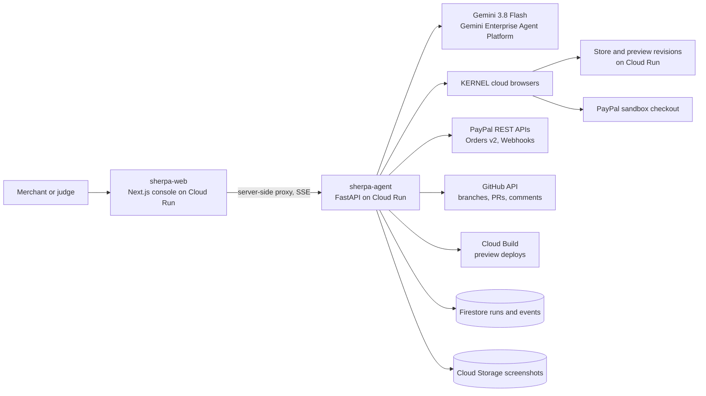

# Sherpa

**The AI integration engineer for PayPal checkout and agentic commerce.**

Give Sherpa a store URL and its GitHub repo. It shops the live store like a real customer, finds what's wrong with the PayPal checkout, fixes it in a pull request, proves the fix with a real PayPal sandbox payment, and makes the store ready for AI shopping agents.

- **Live console:** https://sherpa-web-854441956422.us-east1.run.app
- **Demo video:** [VIDEO_URL]
- **Demo store repos:** [sherpa-demo-ember-oak](https://github.com/nnam-droid12/sherpa-demo-ember-oak) · [sherpa-demo-lumen-bakehouse](https://github.com/nnam-droid12/sherpa-demo-lumen-bakehouse)

> Everything runs against the **PayPal sandbox**. Sherpa refuses to start if it is pointed at live PayPal.

---

## The problem

Where PayPal appears in a checkout, how it looks, and whether it is offered at the right moment decide whether shoppers pick it. Many stores still run older integrations: the legacy JS SDK, a PayPal button below the fold, no Venmo or Pay Later, client-side amounts, unverified webhooks. Fixing that takes hands-on integration work that most merchants don't have time for.

<!-- TODO: add the sourced statement from PayPal's earnings call about merchant integration support (link the transcript). -->

Agentic commerce has the same bottleneck. Before an AI agent can buy from a store, the store has to expose its catalog and cart endpoints. PayPal's [Store Sync](https://developer.paypal.com/store-sync/overview) connects a merchant's catalog and commerce API to PayPal's agentic services, and PayPal [acquired Cymbio](https://www.techrepublic.com/article/news-paypal-buys-cymbio/) to accelerate it. But every merchant still has to build the endpoints.

## What Sherpa does

| Step | What happens |
|---|---|
| **1. Audit** | A Gemini computer-use agent shops the live store in KERNEL cloud browsers on desktop (1440×900) and mobile (390×844). It finds a product over $200, adds it to the cart and tries to pay with PayPal, narrating as it goes. Deterministic checks measure the button position, SDK version, Venmo and Pay Later, webhooks and agent-readiness. Every step is recorded with screenshots and a session replay. |
| **2. Fix** | A Gemini 3.8 Flash coding agent reads the repo and makes the changes: JS SDK v6, PayPal and Venmo above the fold, Pay Later messaging, server-side amount checks, verified webhooks, graceful errors. It must pass the build and Sherpa's own acceptance checks before it can finish. Then it opens a real pull request written for the merchant. |
| **3. Verify** | Sherpa deploys the PR branch as a tagged, no-traffic Cloud Run revision, re-runs the same shopper on desktop and mobile, completes a real sandbox payment, confirms it through the Orders API, and posts a before/after scorecard on the PR. |
| **4. Agent-ready** | The coding agent adds a product catalog feed and the PayPal Cart API v1 endpoints (`/merchant-cart`) wired to PayPal Orders, plus contract tests. An AI buyer agent then discovers the store and buys through PayPal: *"I need a birthday cake for 12 people delivered Saturday, under $90."* |

### Results on the demo stores

Two intentionally flawed fictional stores ship with Sherpa. Every planted flaw is listed in [`docs/SCORECARD.md`](docs/SCORECARD.md).

| Store | Planted flaws found by the audit | Score before | Score after |
|---|---|---|---|
| Ember & Oak (HTML/JS + Express) | 9 / 9 | 15 | **86**, with a real sandbox payment `COMPLETED` on the preview ([PR #1](https://github.com/nnam-droid12/sherpa-demo-ember-oak/pull/1)) |
| Lumen Bakehouse (Next.js) | 7 / 7 | 18 | _pending live verify_ |

## Architecture



- **Console (`apps/web`):** Next.js 15 App Router. It streams run events over server-sent events through a server-side proxy, so the agent API key never reaches the browser.
- **Agent (`services/agent`):** FastAPI on Python 3.12. Each stage runs as a background job that writes to Firestore and streams events.
  - `audit/`: the computer-use shopper, static checks, the deterministic rubric and the findings writer
  - `fixer/`: the coding agent, its sandboxed tools and the GitHub flow
  - `verify/`: preview deploys through the Cloud Build and Cloud Run Admin APIs
  - `agentready/`: the Cart API contract and contract tests
  - `buyer/`: the AI buyer agent
- **Scores are deterministic.** Gemini writes only the plain-English wording of each finding. Weights and checks are in [`docs/SCORECARD.md`](docs/SCORECARD.md).

More detail: [`docs/ARCHITECTURE.md`](docs/ARCHITECTURE.md) · design decisions: [`docs/DECISIONS.md`](docs/DECISIONS.md).

## How PayPal is used

| PayPal product | Where |
|---|---|
| **JS SDK v6** (`web-sdk/v6/core`, `createInstance`, `findEligibleMethods`, payment sessions, web components) | What the fixer migrates stores to; the audit detects v5 vs v6 |
| **Orders v2** | Store checkout, server-side amount checks, payment confirmation in verify |
| **Venmo** (`venmo-payments`, `<venmo-button>`) | Added by the fixer for eligible US buyers |
| **Pay Later messaging** (`paypal-messages`, `<paypal-message>`) | Added on product and cart pages |
| **Webhooks + `verify-webhook-signature`** | Added by the fixer for `PAYMENT.CAPTURE.COMPLETED`, `PAYMENT.CAPTURE.DENIED` and `CHECKOUT.ORDER.APPROVED` |
| **Cart API v1** (`/merchant-cart`) | Generated for agent-ready stores; contract in [`cart_api.md`](services/agent/sherpa/agentready/cart_api.md) |
| **Agent Toolkit** (`paypal-agent-toolkit`, Orders actions) | The buyer agent checks order status with it |
| **Best-practice references** ([paypal/AI-Toolkit](https://github.com/paypal/AI-Toolkit)) | Fetched at runtime as grounding for the coding agent |

## How Gemini is used

All model calls run on **Gemini Enterprise Agent Platform (formerly Vertex AI)** with the `google-genai` SDK in Vertex mode, authenticated with Application Default Credentials and a least-privilege service account. There is no API key anywhere.

- **Computer use** (`gemini-3.8-flash`, browser environment): the shopper and the PayPal approval step.
- **Structured output** (JSON schema): plain-English impact and fix text for each finding.
- **Coding agent** (`gemini-3.8-flash`, thinking `HIGH`, function calling): the fixer.
- **Function calling**: the AI buyer agent that drives the Cart API.

## Other tools

KERNEL cloud browsers (live view and replays) · Google Cloud Run · Cloud Build · Artifact Registry · Firestore · Cloud Storage · Secret Manager · GitHub REST API.

## Try it in 2 minutes

1. Open the [console](https://sherpa-web-854441956422.us-east1.run.app).
2. Click **Use Ember & Oak** or **Use Lumen Bakehouse**, then **Start audit**. Or click **View a recent run instantly** to open a finished run.
3. Watch the live browser and timeline, then follow **Fix it → Deploy preview & verify → Make agent-ready**.

Public runs are rate limited per visitor to protect cloud credits.

## Run it yourself

**Prerequisites:** Python 3.12, Node 22, the Google Cloud SDK, a GitHub account, a PayPal developer account and a KERNEL account.

1. **PayPal sandbox:** in the [developer dashboard](https://developer.paypal.com/dashboard/accounts), create a **US business** sandbox account and a **US personal** sandbox account. Then go to **Apps & Credentials → Create App (Sandbox)** and link it to the US business account.
2. **KERNEL:** create an API key at https://dashboard.onkernel.com.
3. **Google Cloud:** enable Vertex AI, Cloud Run, Cloud Build, Artifact Registry, Secret Manager and Firestore. Then run `gcloud auth application-default login`. No Gemini API key is needed.
4. **GitHub:** create a fine-grained token limited to your store repos, with read/write on Contents, Pull requests and Issues.
5. Copy `.env.example` to `.env` and fill it in.
6. Run it locally:
   ```bash
   python -m venv .venv && .venv/bin/pip install -e "services/agent[dev]"
   cd services/agent && ../../.venv/bin/uvicorn sherpa.main:app --port 8080
   cd apps/web && npm install && SHERPA_AGENT_URL=http://localhost:8080 npm run dev
   ```
7. Deploy to Cloud Run:
   ```bash
   infra/secrets.sh        # .env -> Secret Manager (values are never printed)
   infra/deploy.sh all     # stores, agent, console
   infra/reset-demo.sh     # reset the demo repos to their flawed baseline
   ```

## Limitations and honesty notes

- **Sandbox only.** Sherpa asserts the sandbox base URL at startup.
- **Computer use is in preview.** The shopper occasionally needs more steps on unfamiliar layouts; its scores don't depend on that, because scoring is deterministic.
- **The buyer agent plays PayPal's role.** In production, PayPal's Commerce Platform calls the merchant's Cart API after Store Sync onboarding. In this build, Sherpa's buyer agent plays that caller against the sandbox, and approves the PayPal order through the computer-use agent as the sandbox buyer.
- **Cart API caller authentication** (the PayPal-issued JWT) is out of scope for the sandbox demo.

## License

[MIT](LICENSE)
