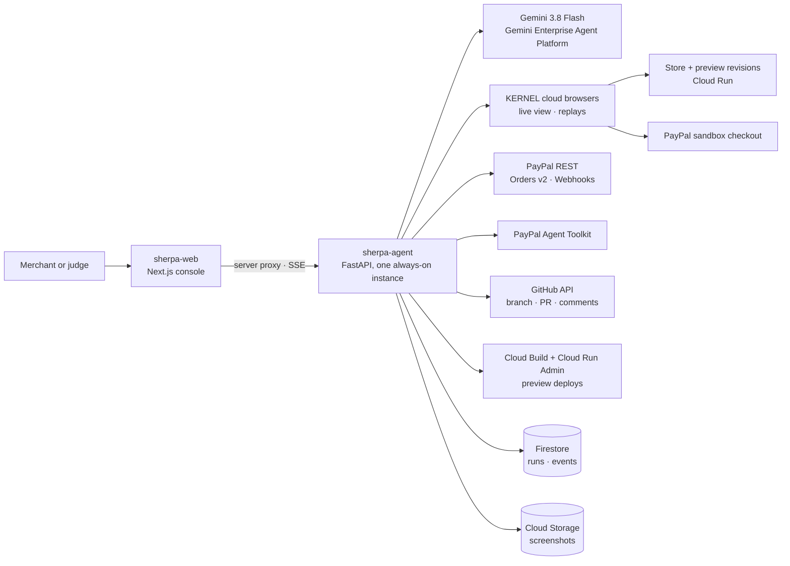

# Architecture

## Components

| Component | What it does |
|---|---|
| `apps/web` | Next.js 15 console: landing page, no-login dashboard, and the run page (mission bar, live browser, scorecard, code workspace, verify receipt, agent-ready showcase). It talks to the agent only through a server-side proxy, so the API key never reaches the browser. Progress streams over server-sent events. |
| `services/agent` | FastAPI. Each stage runs as a background job with a heartbeat and a stop signal, persisted to Firestore and streamed as events. |
| `sherpa/browser` | KERNEL sessions over CDP with desktop and mobile profiles, a host allowlist, replays, and cleanup in `finally` blocks. |
| `sherpa/audit` | The computer-use shopper (Gemini 3.8 Flash, `ENVIRONMENT_BROWSER`), in-page probes, static code checks, the deterministic rubric and the structured-output findings writer. |
| `sherpa/fixer` | A coding agent (Gemini 3.8 Flash, thinking `HIGH`) with sandboxed file tools, a build gate, deterministic self-checks, live file and diff streaming, and the GitHub flow. |
| `sherpa/verify` | A Cloud Build job deploys the PR as a tagged, no-traffic revision; the audit re-runs against the preview; the sandbox order is confirmed through the Orders API; the scorecard is commented on the PR. |
| `sherpa/agentready` | The Cart API v1 contract, the agent-ready task for the coding agent, and a live contract test suite. |
| `sherpa/buyer` | An AI buyer agent using function calling, catalog search, Cart API calls, PayPal approval in a cloud browser, and Agent Toolkit order checks. |

## A run, end to end

1. **Audit:** two shoppers (desktop and mobile) run in parallel in KERNEL. Probes record the PayPal button's position and visibility, crashes and payment gates. Static checks read the HTML and the repo. The rubric scores deterministically, and Gemini writes the plain-English impact and fix for each finding.
2. **Fix:** the repo is cloned to `/tmp` and the agent receives the findings, the store's source and PayPal's best-practice references. It edits, builds and self-checks, then commits only the files it changed and opens a PR.
3. **Verify:** the PR branch is uploaded, built and deployed with `--tag pr-N --no-traffic`. The shoppers re-run against the preview URL, and a completed order is confirmed through the Orders API.
4. **Agent-ready:** the coding agent adds `/catalog.json` and `/merchant-cart` as a second commit, the preview is redeployed, contract tests run live, then the buyer agent purchases through the Cart API.

## Reliability

- A single always-on agent instance (min 1, max 1, CPU always allocated), so long background jobs aren't shut down.
- A heartbeat every ~45 s; a running stage with no heartbeat for 4 minutes is marked *Interrupted* and can be retried.
- A Stop button sets a flag that the job polls; cancellation runs each stage's cleanup, which closes browsers and deletes clones.
- Event IDs are unique across instances, and the full run is broadcast after every update.
- Gemini calls retry on 408, 429 and 5xx with exponential backoff of up to a minute.
